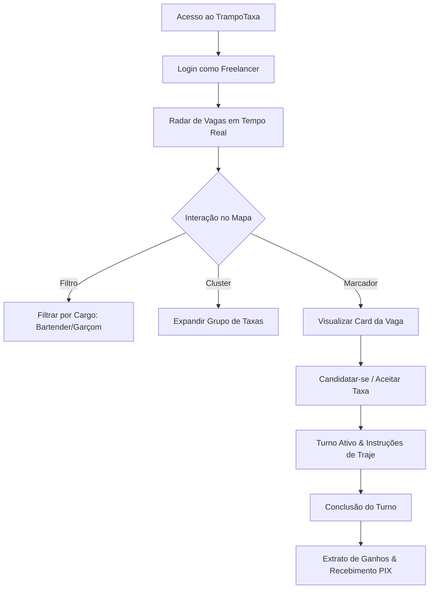
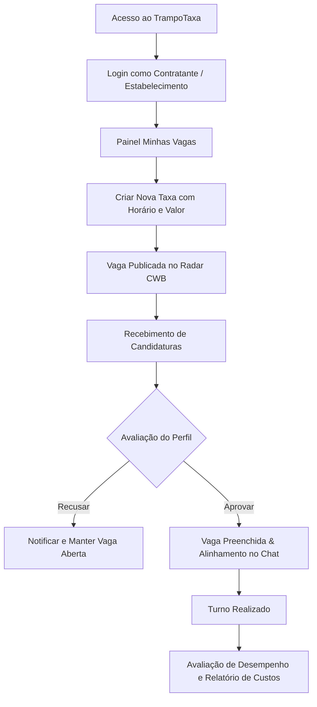

# Plano de Especificação: Reestruturação e Fluxos de Uso dos READMEs do Monorepo

Plano formal para a reorganização completa, didática e padronizada de todos os arquivos `README.md` do ecossistema TrampoTaxa, com diagramas visuais (Mermaid e ASCII) dos fluxos de uso (Contratante e Freelancer), guias de ambiente, mapeamento de APIs e resolução de problemas comuns.

> [!IMPORTANT]
> **Conformidade com a Regra de Ouro do Spec-Kit (Scope Guard):**
> Nenhuma linha de código ou arquivo de documentação real (`README.md` fora de `specs/`) será alterado nesta fase. As alterações só serão executadas quando a fase for aprovada e o comando `implement` for acionado.

---

## User Review & Critical Decisions

### Decisões Confirmadas com o Usuário:
1. **Formato dos Fluxos de Uso:** Diagramas visuais interativos em **Mermaid** e **ASCII** para cada jornada (Contratante e Freelancer), demonstrando visualmente o passo a passo de ponta a ponta.
2. **Seções Adicionais Selecionadas:**
   - Resumo completo de endpoints da API RESTful e contratos OpenAPI 3.0.
   - Guia de Troubleshooting para problemas comuns no Bun e Metro/Expo Bundler.
   - Guia completo de variáveis de ambiente (`.env`) e setup local.
   - Diagramas de arquitetura do monorepo e árvore de diretórios explicativa.
3. **Escopo do README Mobile:** Focado em inicialização ágil com **Expo Go** e testes locais, sem complexidade de pipelines de CI/CD ou credenciais EAS.

---

## 1. Overview & Estrutura Alvo de Cada README

A documentação será particionada e especializada por escopo, evitando duplicações desnecessárias:

### 1.1. `README.md` (Raiz do Monorepo) — Portal Geral de Engenharia
- **Visão Executiva & Badges:** Métricas de qualidade, suíte de 73+ testes, Bun Workspaces, 0% débito técnico.
- **Topologia do Monorepo:** Diagrama ASCII do workspace e árvore de diretórios anotada.
- **Fluxos Globais de Uso (Jornadas do Usuário em Mermaid):**
  - **Jornada do Freelancer:** Login -> Radar de Vagas -> Filtros -> Detalhes -> Aceitar Vaga -> Turno Ativo -> Extrato de Ganhos / PIX.
  - **Jornada do Contratante:** Login -> Minhas Vagas -> Criar Vaga de Taxa -> Candidaturas -> Aprovar/Recusar -> Chat com Freelancer -> Avaliação & Relatórios.
- **Setup Local & Guia de Desenvolvimento:** Instalação limpa com Bun, script de inicialização simultânea, variáveis de ambiente.
- **Troubleshooting Geral:** Resolução de conflitos de portas (3000/3001), cache do Bun, lockfiles e processos zumbis.

### 1.2. `apps/web/README.md` — SPA, PWA e Interface de Produção
- **Arquitetura Web:** React 19, Tailwind CSS v4, TanStack React Query v5 e Vite.
- **Experiência do Freelancer na Web:** Radar com mapa full-bleed (`h-screen overflow-hidden`), clustering geoespacial (`use-supercluster`), fallback vetorial interativo.
- **Experiência do Contratante na Web:** Painel de gestão de taxas, triagem de candidatos em tempo real, relatórios gerenciais e chat.
- **PWA e Suporte Offline:** Registro de Service Worker e políticas de cache Workbox (`NetworkFirst` vs `CacheFirst`).
- **Resolução de Problemas Web:** Erros comuns do Vite, recarga de service workers, limpeza de cache local.

### 1.3. `apps/mobile/README.md` — Aplicativo Nativo Expo Go
- **Arquitetura Mobile:** React Native 0.74, Expo SDK 51, React Navigation Bottom Tabs.
- **Fluxo do Freelancer no Mobile:**
  - Aba 1 (Radar): Consulta geolocalizada e pull-to-refresh nativo.
  - Aba 2 (Ganhos): Cards de faturamento e extrato via `FlatList`.
  - Aba 3 (Perfil): Métricas de pontualidade, dados bancários e chave PIX.
- **Guia Rápido Expo Go:** Inicialização via QR Code, modo túnel (`--tunnel`), pareamento com smartphone físico.
- **Troubleshooting Mobile:** Erros comuns do Metro Bundler, cache do Expo (`bunx expo start -c`) e resolução de módulos monorepo.

### 1.4. `packages/shared/README.md` — Contratos, Tipagens e API Core
- **Contratos OpenAPI 3.0:** Matriz de endpoints RESTful com tags, métodos e parâmetros.
- **Pipeline Orval:** Como o comando `bun run api:generate` transforma `openapi.yaml` em hooks React Query tipados.
- **Formatadores Fiscais:** Validação Módulo 11 de CNPJs, sanitização de números e máscaras financeiras BRL.
- **Isolamento de Mocks:** Regras de segregação de dados de teste fora do bundle de produção.

---

## 2. Diagramas de Fluxo a Serem Incorporados

### Fluxo do Freelancer (Mermaid):

### Fluxo do Contratante (Mermaid):

---

## 3. Plano de Fases e Verificação

- [ ] **Fase 1 (Atual - Specify/Plan):**
  - Criação da especificação formal em `specs/004-readme-flows-overhaul/spec.md`.
  - Checklist de qualidade em `specs/004-readme-flows-overhaul/checklists/requirements.md`.
  - Submissão deste plano para aprovação do usuário.
- [ ] **Fase 2 (Após Aprovação do Usuário via `implement`):**
  - Criação de `specs/004-readme-flows-overhaul/tasks.md`.
  - Execução sequencial das tarefas de atualização dos READMEs reais.
  - Validação estática com `bun run lint` e testes com `bun test`.
