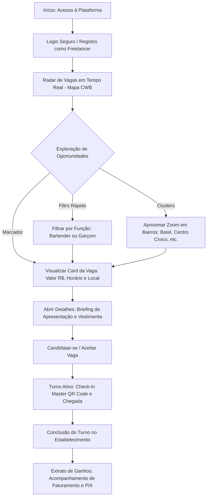
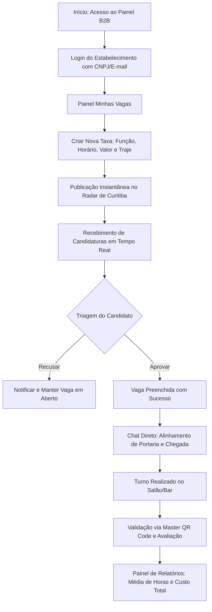
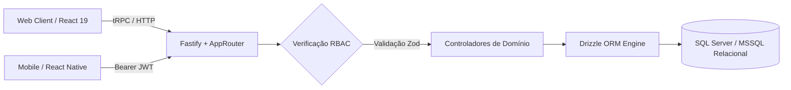

# 🍸 TrampoTaxa (Loctaxa) — Monorepo de Gestão de Taxas & Freelancers

[](https://github.com/akirarafael19/trampo-taxa/actions/workflows/deploy.yml)
[](https://github.com/akirarafael19/trampo-taxa/actions/workflows/mobile-build.yml)
[](https://bun.sh/)
[](https://www.typescriptlang.org/)
[](https://react.dev/)
[](https://reactnative.dev/)
[](https://expo.dev/)
[](https://trpc.io/)
[](https://orm.drizzle.team/)
[](https://vitest.dev/)
[](https://eslint.org/)

O **TrampoTaxa (Loctaxa CWB)** é uma plataforma digital corporativa em arquitetura monorepo de alto desempenho voltada a conectar **estabelecimentos gastronômicos** (bares, pubs, restaurantes e casas noturnas) a **profissionais autônomos e freelancers** (bartenders, garçons, cozinheiros e recepcionistas) para cobertura de turnos operacionais pontuais (*taxas*) em tempo real em Curitiba e Região Metropolitana.

---

## 🌐 Links Rápidos do Ecossistema

* 🚀 **Aplicação Web (GitHub Pages):** [https://akirarafael19.github.io/trampo-taxa/](https://akirarafael19.github.io/trampo-taxa/)
* 💻 **Repositório GitHub:** [https://github.com/akirarafael19/trampo-taxa](https://github.com/akirarafael19/trampo-taxa)
* 🧪 **Ambiente de Desenvolvimento em Nuvem:** [Acessar Applet Ativo](https://ais-dev-v6aa5zop4sov5raedzqgg4-97325856245.us-east1.run.app)

---

## 🗺️ Mapa de Navegação da Documentação Modular (Architecture Map)

Para facilitar a exploração e a manutenção pontual, o monorepo conta com documentações modulares dedicadas a cada workspace e submódulo arquitetural:

| Módulo / Camada | Documentação Dedicada | Descrição Técnica |
| :--- | :--- | :--- |
| **Monorepo Raiz** | [README.md](./README.md) | Visão holística, comandos Bun, variáveis globais e governança |
| **Backend Server** | [apps/server/README.md](./apps/server/README.md) | Servidor tRPC v11, Drizzle ORM, Fastify, driver MSSQL e rotas |
| ↳ *Server Database* | [apps/server/src/db/README.md](./apps/server/src/db/README.md) | Conexão pool (`client.ts`), schemas relacionais (`schema.ts`) e dados de seed (`seed.ts`) |
| ↳ *Server Routers* | [apps/server/src/routers/README.md](./apps/server/src/routers/README.md) | Routers tRPC: `auth`, `gigs`, `chat`, `contractor`, `freelancer` |
| ↳ *Server tRPC Core* | [apps/server/src/trpc/README.md](./apps/server/src/trpc/README.md) | Inicialização do tRPC, procedimentos públicos e middleware RBAC com contexto |
| **Frontend Web** | [apps/web/README.md](./apps/web/README.md) | SPA e PWA React 19, Vite, Tailwind CSS, Workbox e mapas |
| ↳ *Web Components* | [apps/web/src/components/README.md](./apps/web/src/components/README.md) | Componentes atômicos, mapa vetorial, modais de fluxo e chat |
| ↳ *Web Contexts* | [apps/web/src/context/README.md](./apps/web/src/context/README.md) | Provedores de estado reativo: `AuthContext`, `FreelancerFlowContext`, `ContractorContext` |
| ↳ *Web Hooks* | [apps/web/src/hooks/README.md](./apps/web/src/hooks/README.md) | Hooks customizados: `useFreelancerGigFlow` e `useGigsQuery` |
| ↳ *Web Routes* | [apps/web/src/routes/README.md](./apps/web/src/routes/README.md) | Configuração de rotas e guardas de autorização (`ProtectedRoute`) |
| ↳ *Web Screens* | [apps/web/src/screens/README.md](./apps/web/src/screens/README.md) | Telas completas de Freelancer, Contratante e Autenticação |
| **Mobile App** | [apps/mobile/README.md](./apps/mobile/README.md) | Aplicativo móvel nativo Expo SDK 51, React Native e Metro Bundler |
| ↳ *Mobile API* | [apps/mobile/src/api/README.md](./apps/mobile/src/api/README.md) | Cliente HTTP autenticado com injeção automática de token JWT |
| ↳ *Mobile Contexts* | [apps/mobile/src/context/README.md](./apps/mobile/src/context/README.md) | Gerenciamento de sessão móvel, armazenamento seguro e fluxo de turno |
| ↳ *Mobile Navigation*| [apps/mobile/navigation/README.md](./apps/mobile/navigation/README.md) | BottomTabs nativas, autenticação e tipagem de rotas |
| ↳ *Mobile Screens* | [apps/mobile/src/screens/README.md](./apps/mobile/src/screens/README.md) | Telas nativas de Radar, Turno Ativo, Extrato e Painel B2B |
| **Shared Package** | [packages/shared/README.md](./packages/shared/README.md) | Contratos OpenAPI 3.0, geração de hooks Orval, utilitários fiscais |
| ↳ *Shared API* | [packages/shared/src/api/README.md](./packages/shared/src/api/README.md) | Clientes e modelos tipados gerados pelo pipeline OpenAPI |
| ↳ *Shared Data* | [packages/shared/src/data/README.md](./packages/shared/src/data/README.md) | Datasets mock de Curitiba (`mockGigs`, `mockContractorData`) |
| ↳ *Shared Types* | [packages/shared/src/types/README.md](./packages/shared/src/types/README.md) | Interfaces canônicas de domínio compartilhadas entre Web e Mobile |
| ↳ *Shared Utils* | [packages/shared/src/utils/README.md](./packages/shared/src/utils/README.md) | Validadores fiscais (CNPJ Módulo 11), formatadores BRL e lógica de turnos |

---

## 🧭 Fluxos de Uso do Sistema (Jornadas Operacionais)

O TrampoTaxa orquestra fluxos entre três camadas interdependentes: **Freelancer**, **Contratante** e o **Backend Transacional**:

### 1. Fluxo do Freelancer (Profissional de Bar & Atendimento)



### 2. Fluxo do Contratante (Estabelecimento Gastronômico B2B)



### 3. Fluxo de Dados e Persistência do Backend (`apps/server`)



---

## 🏛️ Topologia e Estrutura de Diretórios do Monorepo

O monorepo utiliza **Bun Workspaces**, garantindo separação arquitetural e compartilhamento estrito de contratos:

```
trampo-taxa/
├── apps/
│   ├── server/                       # Backend Fastify + tRPC v11 + Drizzle ORM (SQL Server)
│   │   ├── src/
│   │   │   ├── db/                   # Pool de conexões, schemas e script de seed
│   │   │   ├── routers/              # Procedimentos tRPC (auth, gigs, chat, contractor, freelancer)
│   │   │   ├── trpc/                 # Inicialização, contexto de autenticação e RBAC
│   │   │   └── index.ts              # Ponto de entrada do servidor HTTP Fastify
│   │   └── package.json              # Dependências do servidor backend
│   │
│   ├── web/                          # Aplicação SPA & PWA (React 19 + Vite)
│   │   ├── docs/                     # Contratos OpenAPI 3.0 e MER de Banco
│   │   ├── public/                   # Manifesto PWA, ícones e assets estáticos
│   │   ├── src/
│   │   │   ├── components/           # Marcadores, Clusters, Chat, Modais e UI Atômica
│   │   │   ├── context/              # Autenticação RBAC e Estados Operacionais
│   │   │   ├── hooks/                # Hooks customizados para fluxo e queries
│   │   │   ├── layouts/              # AppLayout com header limpo e navegação
│   │   │   ├── routes/               # Proteção de rotas por perfil (/map vs /contractor)
│   │   │   └── screens/              # Telas de Freelancer e Contratante
│   │   └── vite.config.ts            # Vite com PWA Workbox e aliases de monorepo
│   │
│   └── mobile/                       # Aplicativo Mobile Nativo (Expo SDK 51)
│       ├── navigation/               # BottomTabs nativas (Radar, Ganhos, Perfil)
│       ├── src/
│       │   ├── api/                  # Clientes e fetch autenticado Bearer JWT
│       │   ├── context/              # AuthContext mobile com SecureStore
│       │   ├── hooks/                # Hooks de sincronização de turno
│       │   └── screens/              # Telas com FlatList e componentes nativos
│       ├── app.json                  # Manifesto Expo com permissões
│       └── metro.config.js           # Resolução de symlinks e pacotes monorepo
│
├── packages/
│   └── shared/                       # Pacote Central de Lógica e Contratos
│       ├── src/
│       │   ├── api/                  # Hooks React Query gerados pelo Orval
│       │   ├── data/                 # Datasets mock de Curitiba (mockGigs, mockContractorData)
│       │   ├── types/                # Entidades canônicas (User, Gig, Contractor...)
│       │   └── utils/                # Validadores fiscais (CNPJ Módulo 11, formatadores BRL)
│       ├── openapi.yaml              # Especificação formal da API RESTful
│       └── orval.config.ts           # Configuração de geração automatizada de contratos
│
├── specs/                            # Metodologia Spec-Kit (Documentação Viva e Contratos)
│   ├── 001-engineering-foundation/   # Fundação técnica do monorepo
│   ├── 002-refatoracao-critica.../   # Refatorações críticas de arquitetura
│   ├── 003-docs-system-readme-sync/  # Sincronização documental
│   ├── 004-readme-flows-overhaul/    # Reformulação de jornadas operacionais
│   ├── 005-contractor-dashboard/     # Painel de gestão do contratante
│   ├── 006-jornada-freelancer.../    # Fluxo interdependente freelancer/contratante
│   ├── 007-backend-drizzle-mssql.../ # Backend tRPC + Drizzle ORM + SQL Server
│   └── 008-modular-readme-docs/      # Matriz modular de READMEs
│
├── package.json                      # Scripts globais do monorepo
└── bun.lock                          # Lockfile determinístico do Bun
```

---

## 🛠️ Guia de Instalação e Desenvolvimento Local

### 1. Pré-requisitos
* **Bun:** v1.2+ instalado ([Instruções do Bun](https://bun.sh/)).
* **Node.js:** v20+ ou v24 (para suporte ao compilador Expo e scripts auxiliares).
* **Git:** Para versionamento e clone do repositório.

### 2. Passo a Passo de Instalação

```bash
# 1. Clonar o repositório
git clone https://github.com/akirarafael19/trampo-taxa.git
cd trampo-taxa

# 2. Instalar todas as dependências dos 4 workspaces via Bun
bun install

# 3. Executar o servidor de desenvolvimento Web (acessível em http://localhost:3000)
bun run dev:web

# 4. Executar o servidor backend tRPC (porta 3001)
bun --filter @trampotaxa/server dev

# 5. Executar o Metro Bundler do aplicativo móvel Expo
bun run dev:mobile
```

---

## ⚙️ Variáveis de Ambiente (`.env`)

Crie os arquivos de ambiente correspondentes baseando-se nos arquivos `.env.example`:

### Web (`apps/web/.env`)
```env
# Google Maps API (Opcional - caso ausente, o mapa vetorial MinimalVectorMap assume automaticamente)
VITE_GOOGLE_MAPS_API_KEY=sua_chave_aqui
DISABLE_HMR=false
```

### Backend Server (`apps/server/.env`)
```env
PORT=3001
DATABASE_URL=sqlserver://localhost:1433;database=trampotaxa;user=sa;password=YourPassword123!;encrypt=false
JWT_SECRET=super-secret-trampotaxa-jwt-key
```

---

## 💻 Resumo de Comandos Oficiais (Bun)

| Comando | Finalidade |
| :--- | :--- |
| `bun install` | Instala e sincroniza todas as dependências de todos os workspaces |
| `bun run dev:web` | Inicia o servidor Vite da aplicação Web na porta 3000 |
| `bun run dev:mobile` | Inicia o Metro Bundler do aplicativo móvel Expo |
| `bun --filter @trampotaxa/server dev` | Inicia o servidor tRPC com recarregamento a quente |
| `bun --filter @trampotaxa/server seed` | Executa o seed de dados no banco relacional |
| `bun test` | Executa a suíte completa de testes automatizados do monorepo |
| `bun run lint` | Executa a checagem do ESLint em todo o monorepo (0 erros e 0 warnings) |
| `bun run api:generate` | Gera clientes e hooks a partir do `openapi.yaml` com Orval |
| `bun run typecheck:mobile` | Valida a tipagem TypeScript estrita do app móvel |
| `bun run build:web` | Gera o bundle de produção otimizado com Service Worker PWA |

---

## 🔧 Guia de Troubleshooting

### 1. Erro: "Port 3000 is in use, trying another one..."
* **Sintoma:** O Vite sobe na porta 3001 e a visualização no navegador/iFrame falha.
* **Causa:** Processo anterior retido em segundo plano.
* **Solução:**
  ```bash
  fuser -k 3000/tcp 3001/tcp 2>/dev/null || kill -9 $(pgrep -f "vite") 2>/dev/null
  bun run dev:web
  ```

### 2. Cache Desatualizado no Bun ou no Expo
* **Sintoma:** Alterações em `@trampotaxa/shared` não aparecem na Web ou Mobile.
* **Solução:**
  ```bash
  rm -rf node_modules apps/*/node_modules
  bun install
  cd apps/mobile && bunx expo start -c
  ```

### 3. Fallback Resiliente de Mapas
* **Comportamento Esperado:** Se nenhuma chave do Google Maps for configurada em `apps/web/.env`, o sistema entra automaticamente no modo **Resiliente com Mapa Vetorial** (`MinimalVectorMap`), oferecendo agrupamento geoespacial via `use-supercluster` sem travar a interface do usuário.
