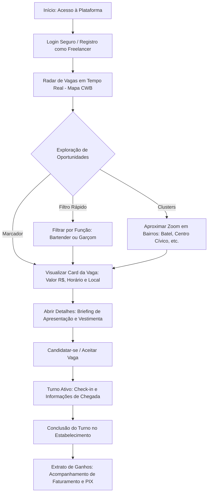
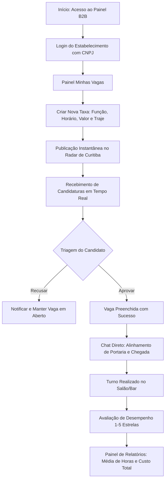

# 🍸 TrampoTaxa (Loctaxa) — Monorepo de Gestão de Taxas & Freelancers

[](https://github.com/akirarafael19/trampo-taxa/actions/workflows/deploy.yml)
[](https://github.com/akirarafael19/trampo-taxa/actions/workflows/mobile-build.yml)
[](https://bun.sh/)
[](https://www.typescriptlang.org/)
[](https://react.dev/)
[](https://reactnative.dev/)
[](https://expo.dev/)
[](https://vitest.dev/)
[](https://eslint.org/)

O **TrampoTaxa (Loctaxa CWB)** é uma plataforma digital desenvolvida em arquitetura monorepo voltada a conectar **estabelecimentos gastronômicos** (bares, restaurantes, pubs e casas de eventos) a **profissionais autônomos e freelancers** (bartenders, garçons, cozinheiros e recepcionistas) para cobertura de turnos pontuais (*taxas*) em tempo real em Curitiba e Região Metropolitana.

---

## 🌐 Links Rápidos do Ecossistema

* 🚀 **Aplicação Web (GitHub Pages):** [https://RafaelAFujii.github.io/TrampoTaxa/](https://RafaelAFujii.github.io/TrampoTaxa/)
* 💻 **Repositório GitHub:** [https://github.com/RafaelAFujii/TrampoTaxa](https://github.com/RafaelAFujii/TrampoTaxa)
* 🧪 **Ambiente de Desenvolvimento em Nuvem:** [Acessar Applet Ativo](https://ais-dev-v6aa5zop4sov5raedzqgg4-97325856245.us-east1.run.app)

---

## 🧭 Fluxos de Uso do Sistema (Jornadas Operacionais)

O TrampoTaxa possui fluxos de experiência desenhados especificamente para dois papéis fundamentais: **Freelancer** e **Contratante**.

### 1. Fluxo do Freelancer (Profissional de Atendimento & Bar)

O profissional busca turnos com remuneração transparente, regras claras de vestimenta e agilidade de pagamento.



```
[VISÃO FREELANCER - ASCII]
┌──────────────┐     ┌──────────────┐     ┌──────────────┐     ┌──────────────┐
│  Radar Mapa  │ ──> │   Card da    │ ──> │ Turno Ativo  │ ──> │  Extrato de  │
│ em Tempo Real│     │ Vaga (Taxa)  │     │ & Vestimenta │     │ Ganhos / PIX │
└──────────────┘     └──────────────┘     └──────────────┘     └──────────────┘
```

---

### 2. Fluxo do Contratante (Estabelecimento / Restaurante / Bar)

O contratante publica vagas emergenciais ou programadas, avalia candidatos verificados, alinha detalhes e gerencia custos.



```
[VISÃO CONTRATANTE - ASCII]
┌──────────────┐     ┌──────────────┐     ┌──────────────┐     ┌──────────────┐
│  Criar Vaga  │ ──> │ Triagem de   │ ──> │ Chat Direto  │ ──> │ Relatórios & │
│   de Taxa    │     │ Candidaturas │     │ de Alinhamento│     │ Custos B2B   │
└──────────────┘     └──────────────┘     └──────────────┘     └──────────────┘
```

---

## 🏛️ Topologia e Estrutura de Diretórios do Monorepo

O monorepo utiliza o **Bun Workspaces**, garantindo separação arquitetural e compartilhamento estrito de contratos:

```
trampo-taxa/
├── apps/
│   ├── web/                          # Aplicação SPA & PWA (React 19 + Vite)
│   │   ├── docs/                     # Contratos OpenAPI 3.0 e MER de Banco
│   │   ├── public/                   # Manifesto PWA, ícones e assets estáticos
│   │   ├── src/
│   │   │   ├── components/map/       # Marcadores, Clusters e Radar de Vagas
│   │   │   ├── context/              # Autenticação RBAC e Estado do Contratante
│   │   │   ├── layouts/              # AppLayout com header limpo e navegação
│   │   │   ├── routes/               # Proteção de rotas por perfil (/map vs /contractor)
│   │   │   └── screens/              # Telas de Freelancer e Contratante
│   │   ├── orval.config.ts           # Configuração de geração de hooks de API
│   │   └── vite.config.ts            # Vite com PWA Workbox e aliases
│   │
│   └── mobile/                       # Aplicativo Mobile Nativo (Expo SDK 51)
│       ├── src/
│       │   ├── api/                  # Clientes e fetch autenticado Bearer JWT
│       │   ├── context/              # AuthContext mobile com SecureStore
│       │   ├── navigation/           # BottomTabs nativas (Radar, Ganhos, Perfil)
│       │   └── screens/              # Telas com FlatList e componentes nativos
│       ├── app.json                  # Manifesto Expo com permissões
│       └── metro.config.js           # Resolução de symlinks e pacotes monorepo
│
├── packages/
│   └── shared/                       # Pacote Central de Lógica e Contratos
│       ├── src/
│       │   ├── api/                  # Hooks React Query gerados automaticamente
│       │   ├── data/                 # Datasets mock de Curitiba (mockGigs)
│       │   ├── types/                # Entidades canônicas (User, GigOffer...)
│       │   └── utils/                # Validadores fiscais (CNPJ Módulo 11, BRL)
│       └── openapi.yaml              # Especificação formal da API RESTful
│
├── specs/                            # Metodologia Spec-Kit (Documentação Viva)
│   ├── 001-engineering-foundation/   # Fundação técnica do monorepo
│   ├── 002-refatoracao-critica.../   # Refatorações críticas de arquitetura
│   ├── 003-docs-system-readme-sync/  # Sincronização documental
│   └── 004-readme-flows-overhaul/    # Especificação desta reestruturação
│
├── package.json                      # Scripts globais do monorepo
└── bun.lock                          # Lockfile determinístico do Bun
```

---

## 🛠️ Guia de Instalação e Desenvolvimento Local

### 1. Pré-requisitos
* **Bun:** v1.2+ instalado ([Instruções do Bun](https://bun.sh/)).
* **Node.js:** v20+ ou v24 (apenas para compatibilidade do ecossistema Expo).
* **Git:** Clonagem do repositório.

### 2. Passo a Passo de Instalação

```bash
# 1. Clonar o repositório
git clone https://github.com/akirarafael19/trampo-taxa.git
cd trampo-taxa

# 2. Instalar todas as dependências do monorepo via Bun
bun install

# 3. Executar a aplicação Web (acessível em http://localhost:3000)
bun run dev:web

# 4. Executar o servidor Metro do aplicativo móvel
bun run dev:mobile
```

---

## ⚙️ Variáveis de Ambiente (`.env`)

Crie um arquivo `.env` dentro de `apps/web/` (opcional, pois o sistema possui fallback funcional offline e vetorial):

```env
# Google Maps API (Opcional - caso ausente, o mapa vetorial MinimalVectorMap assume automaticamente)
VITE_GOOGLE_MAPS_API_KEY=sua_chave_aqui

# Desativar HMR se operando em contêineres restritos
DISABLE_HMR=false
```

---

## 💻 Resumo de Comandos Oficiais (Bun)

| Comando | Finalidade |
| :--- | :--- |
| `bun install` | Instala e sincroniza todos os pacotes do monorepo |
| `bun run dev:web` | Inicia o servidor Vite da aplicação Web na porta 3000 |
| `bun run dev:mobile` | Inicia o Metro Bundler do aplicativo móvel Expo |
| `bun test` | Executa a suíte de 73 testes automatizados |
| `bun run lint` | Executa verificação do ESLint (0 erros e 0 warnings) |
| `bun run api:generate` | Gera os hooks e tipos da API a partir do `openapi.yaml` com Orval |
| `bun run typecheck:mobile` | Valida a tipagem TypeScript estrita do app móvel |
| `bun run build:web` | Gera o bundle compilado e otimizado com PWA Workbox |

---

## 🔧 Guia de Troubleshooting (Problemas Comuns)

### 1. Erro: "Port 3000 is in use, trying another one..."
* **Sintoma:** O Vite sobe na porta 3001 e o preview do AI Studio / navegador não abre.
* **Causa:** Um processo anterior do Node/Vite ficou retido em segundo plano como zumbi.
* **Solução Imediata:**
  ```bash
  # Localizar e encerrar processos nas portas 3000 e 3001
  fuser -k 3000/tcp 3001/tcp 2>/dev/null || kill -9 $(pgrep -f "vite") 2>/dev/null
  # Reiniciar
  bun run dev:web
  ```

### 2. Cache Desatualizado no Bun ou no Expo
* **Sintoma:** Alterações em `@trampotaxa/shared` não são refletidas no app Web ou Mobile.
* **Solução:**
  ```bash
  # Limpar cache do bundler e reinstalar
  rm -rf node_modules apps/*/node_modules
  bun install
  
  # Para o mobile: reiniciar com flag de limpeza de cache
  cd apps/mobile && bunx expo start -c
  ```

### 3. Falha de Conexão com o Google Maps
* **Comportamento Esperado:** O sistema entra automaticamente no modo **Resiliente com Mapa Vetorial** (`MinimalVectorMap`), permitindo clustering e arrasto sem interromper a navegação do usuário.
