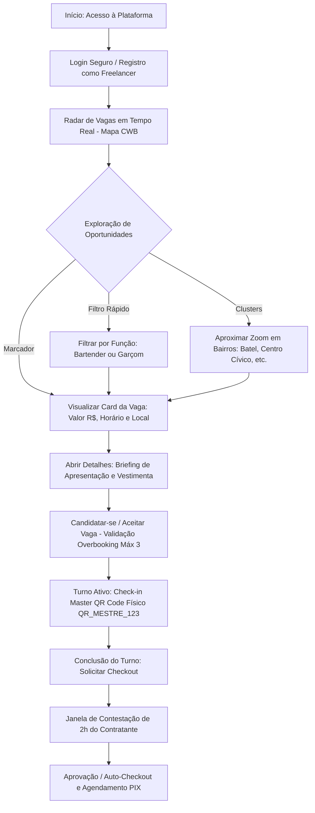
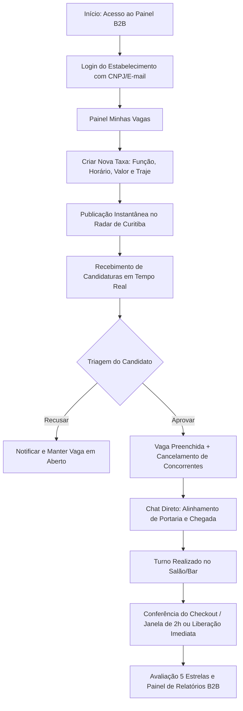

# 🍸 TrampoTaxa (Loctaxa) — Monorepo de Gestão de Taxas & Freelancers

[](https://github.com/akirarafael19/trampo-taxa/actions/workflows/deploy.yml)
[](https://github.com/akirarafael19/trampo-taxa/actions/workflows/mobile-build.yml)
[](https://bun.sh/)
[](https://dotnet.microsoft.com/)
[](https://www.postgresql.org/)
[](https://www.typescriptlang.org/)
[](https://react.dev/)
[](https://reactnative.dev/)
[](https://expo.dev/)
[](https://zustand.docs.pmnd.rs/)
[](https://trpc.io/)
[](https://xunit.net/)

O **TrampoTaxa (Loctaxa CWB)** é uma plataforma digital corporativa em arquitetura monorepo de alto desempenho voltada a conectar **estabelecimentos gastronômicos** (bares, pubs, restaurantes e casas noturnas) a **profissionais autônomos e freelancers** (bartenders, garçons, cozinheiros e recepcionistas) para cobertura de turnos operacionais pontuais (*taxas*) em tempo real em Curitiba e Região Metropolitana.

---

## 🌐 Links Rápidos do Ecossistema

* 🚀 **Aplicação Web (GitHub Pages):** [https://akirarafael19.github.io/trampo-taxa/](https://akirarafael19.github.io/trampo-taxa/)
* 💻 **Repositório GitHub:** [https://github.com/akirarafael19/trampo-taxa](https://github.com/akirarafael19/trampo-taxa)
* 🧪 **Ambiente de Desenvolvimento em Nuvem:** [Acessar Applet Ativo](https://ais-dev-v6aa5zop4sov5raedzqgg4-97325856245.us-east1.run.app)

---

## 🗺️ Mapa de Navegação da Documentação Modular (Architecture Map)

Para facilitar a exploração e a manutenção pontual, o monorepo conta com documentações modulares dedicadas a cada workspace e submódulo arquitetural:

| Módulo / Camada | Documentação Dedicada | Descrição Técnica |
| :--- | :--- | :--- |
| **Monorepo Raiz** | [README.md](./README.md) | Visão holística, comandos Bun / .NET, variáveis globais e governança |
| **Backend .NET 8 (PostgreSQL)** | [apps/server-dotnet/README.md](./apps/server-dotnet/README.md) | ASP.NET Core Web API, EF Core 8 (Npgsql), JWT, BCrypt, PostgreSQL 15 e xUnit |
| **Backend Node.js (tRPC)** | [apps/server/README.md](./apps/server/README.md) | Servidor tRPC v11, Fastify e Drizzle ORM |
| ↳ *Server Database* | [apps/server/src/db/README.md](./apps/server/src/db/README.md) | Conexão pool (`client.ts`), schemas relacionais (`schema.ts`) e dados de seed |
| ↳ *Server Routers* | [apps/server/src/routers/README.md](./apps/server/src/routers/README.md) | Routers tRPC: `auth`, `gigs`, `chat`, `contractor`, `freelancer` |
| ↳ *Server tRPC Core* | [apps/server/src/trpc/README.md](./apps/server/src/trpc/README.md) | Inicialização do tRPC, procedimentos públicos e middleware RBAC |
| **Frontend Web** | [apps/web/README.md](./apps/web/README.md) | SPA e PWA React 19, Vite, Tailwind CSS, Workbox, Mapas e Zustand |
| ↳ *Web Components* | [apps/web/src/components/README.md](./apps/web/src/components/README.md) | Componentes atômicos, mapa vetorial, modais de fluxo e chat |
| ↳ *Web Contexts* | [apps/web/src/context/README.md](./apps/web/src/context/README.md) | Autenticação estática (`AuthContext.tsx`) em conformidade com a Constitution v2 |
| ↳ *Web Hooks* | [apps/web/src/hooks/README.md](./apps/web/src/hooks/README.md) | Hooks re-exportados das stores do Zustand em `@trampotaxa/shared` |
| ↳ *Web Routes* | [apps/web/src/routes/README.md](./apps/web/src/routes/README.md) | Configuração de rotas e guardas de autorização (`ProtectedRoute`) |
| ↳ *Web Screens* | [apps/web/src/screens/README.md](./apps/web/src/screens/README.md) | Telas completas de Freelancer, Contratante e Autenticação (Dumb UI) |
| **Mobile App** | [apps/mobile/README.md](./apps/mobile/README.md) | Aplicativo móvel nativo Expo SDK 51, React Native e Metro Bundler |
| ↳ *Mobile API* | [apps/mobile/src/api/README.md](./apps/mobile/src/api/README.md) | Cliente HTTP autenticado com injeção automática de token JWT |
| ↳ *Mobile Contexts* | [apps/mobile/src/context/README.md](./apps/mobile/src/context/README.md) | Gerenciamento de sessão móvel e SecureStore |
| ↳ *Mobile Navigation*| [apps/mobile/navigation/README.md](./apps/mobile/navigation/README.md) | BottomTabs nativas, autenticação e tipagem de rotas |
| ↳ *Mobile Screens* | [apps/mobile/src/screens/README.md](./apps/mobile/src/screens/README.md) | Telas nativas de Radar, Turno Ativo, Extrato e Painel B2B |
| **Shared Package** | [packages/shared/README.md](./packages/shared/README.md) | Tipos canônicos de domínio, Zustand Stores e utilitários fiscais |
| ↳ *Shared Data* | [packages/shared/src/data/README.md](./packages/shared/src/data/README.md) | Datasets canônicos de Curitiba (`mockGigs`, `mockContractorData`) |
| ↳ *Shared Types* | [packages/shared/src/types/README.md](./packages/shared/src/types/README.md) | Interfaces canônicas de domínio compartilhadas entre Web e Mobile |
| ↳ *Shared Utils* | [packages/shared/src/utils/README.md](./packages/shared/src/utils/README.md) | Stores Zustand (`freelancerFlowState`, `contractorState`), validadores fiscais |

---

## 🧭 Fluxos de Uso do Sistema (Jornadas Operacionais)

O TrampoTaxa orquestra fluxos entre as três camadas do sistema: **Freelancer**, **Contratante** e o **Backend Transacional**:

### 1. Fluxo do Freelancer (Profissional de Bar & Atendimento)



### 2. Fluxo do Contratante (Estabelecimento Gastronômico B2B)



---

## 🏛️ Topologia e Estrutura de Diretórios do Monorepo

```
trampo-taxa/
├── apps/
│   ├── server-dotnet/                # Backend ASP.NET Core .NET 8 + EF Core 8 + PostgreSQL 15
│   │   ├── src/TrampoTaxa.Api/       # Controllers, DbContext, Models, DTOs, JWT Service e Seed
│   │   ├── tests/TrampoTaxa.Api.Tests/ # Suíte de testes automatizados de integração xUnit
│   │   └── TrampoTaxa.sln            # Solução .NET
│   │
│   ├── server/                       # Backend Fastify + tRPC v11 + Drizzle ORM
│   │   ├── src/
│   │   │   ├── db/                   # Schemas relacionais e conexões
│   │   │   ├── routers/              # Routers tRPC (auth, gigs, chat, contractor, freelancer)
│   │   │   ├── trpc/                 # Inicialização, contexto e RBAC
│   │   │   └── index.ts              # Ponto de entrada Fastify
│   │   └── package.json
│   │
│   ├── web/                          # Aplicação SPA & PWA (React 19 + Vite + Zustand)
│   │   ├── public/                   # Manifesto PWA, ícones e assets
│   │   ├── src/
│   │   │   ├── components/           # Marcadores, Clusters, Chat, Modais de Turno
│   │   │   ├── context/              # AuthContext estático
│   │   │   ├── hooks/                # Adaptadores das stores Zustand
│   │   │   ├── layouts/              # AppLayout responsivo
│   │   │   ├── routes/               # Rotas com proteção RBAC
│   │   │   └── screens/              # Telas burras (Dumb UI)
│   │   └── vite.config.ts            # Vite com deduplicação de React e Zustand
│   │
│   └── mobile/                       # Aplicativo Mobile Nativo (Expo SDK 51)
│       ├── navigation/               # BottomTabs nativas
│       ├── src/                      # API, Contexto, Hooks e Telas
│       └── metro.config.js           # Resolução de symlinks e pacotes do monorepo
│
├── packages/
│   └── shared/                       # Pacote Central de Lógica, Domínio e Stores
│       ├── src/
│       │   ├── data/                 # Datasets de Curitiba (mockGigs, mockContractorData)
│       │   ├── types/                # Entidades canônicas (User, Gig, Contractor, etc.)
│       │   └── utils/                # Stores Zustand (freelancerFlowState, contractorState)
│       └── package.json              # React e React-DOM declarados em peerDependencies
│
├── specs/                            # Metodologia Spec-Kit (Documentação Viva e Contratos)
├── package.json                      # Scripts globais do monorepo
└── bun.lock                          # Lockfile determinístico do Bun
```

---

## 👥 Usuários de Teste Reais (PostgreSQL)

Os seguintes usuários estão persistidos no banco de dados com senhas em hash BCrypt (`SenhaSegura123!`):

| Papel | Nome | E-mail | Senha | Detalhes / Chave Pix |
| :--- | :--- | :--- | :--- | :--- |
| **Contratante** | Gerência Bistrô do Batel | `gerencia@bistrobatel.com.br` | `SenhaSegura123!` | CNPJ: `12.345.678/0001-90` (Batel, Curitiba) |
| **Freelancer** | Gabriel Silva | `gabriel.silva@trampotaxa.com.br` | `SenhaSegura123!` | Bartender (Pix: `gabriel.silva@pix.trampotaxa.com.br`) |
| **Freelancer** | Mariana Souza | `mariana.souza@trampotaxa.com.br` | `SenhaSegura123!` | Hostess (Pix: `mariana.souza@pix.trampotaxa.com.br`) |
| **Freelancer** | Lucas Oliveira | `lucas.oliveira@trampotaxa.com.br` | `SenhaSegura123!` | Garçom (Pix: `lucas.oliveira@pix.trampotaxa.com.br`) |

---

## 🛠️ Guia de Instalação e Desenvolvimento Local

### 1. Pré-requisitos
* **Bun:** v1.2+ ([Instruções do Bun](https://bun.sh/)).
* **.NET SDK:** .NET 8.0 LTS instalado ([Download .NET 8](https://dotnet.microsoft.com/download/dotnet/8.0)).
* **PostgreSQL:** Versão 15+ em execução (`localhost:5432`).
* **Node.js:** v20+ ou v24 (para Metro Bundler e scripts auxiliares).

### 2. Passo a Passo de Execução

```bash
# 1. Instalar as dependências do monorepo
bun install

# 2. Executar a aplicação Web (porta 3000)
bun run dev:web

# 3. Executar o backend ASP.NET Core .NET 8 com PostgreSQL
dotnet run --project apps/server-dotnet/src/TrampoTaxa.Api/TrampoTaxa.Api.csproj

# 4. Executar os testes de integração automatizados do backend (.NET xUnit)
dotnet test apps/server-dotnet/tests/TrampoTaxa.Api.Tests/TrampoTaxa.Api.Tests.csproj

# 5. Executar a suíte de testes do monorepo (Bun / Vitest)
bun test
```

---

## ⚙️ Variáveis de Ambiente (`.env`)

### Web (`apps/web/.env`)
```env
# Google Maps API (Opcional - caso ausente, o mapa vetorial MinimalVectorMap assume automaticamente)
VITE_GOOGLE_MAPS_API_KEY=sua_chave_aqui
DISABLE_HMR=false
```

### Backend .NET (`apps/server-dotnet/src/TrampoTaxa.Api/appsettings.json`)
```json
{
  "ConnectionStrings": {
    "DefaultConnection": "Host=localhost;Database=trampotaxa_db;Username=trampotaxa_user;Password=TrampoTaxa2026!"
  },
  "Jwt": {
    "Secret": "TrampoTaxaSecretKeyUltraSecure2026!CuritibaBatelSoho",
    "Issuer": "TrampoTaxa",
    "Audience": "TrampoTaxaClients"
  }
}
```

---

## 💻 Resumo de Comandos Oficiais

| Comando | Finalidade |
| :--- | :--- |
| `bun install` | Instala e sincroniza as dependências de todos os workspaces |
| `bun run dev:web` | Inicia o servidor Vite da aplicação Web na porta 3000 |
| `bun run dev:mobile` | Inicia o Metro Bundler do aplicativo móvel Expo |
| `bun test` | Executa a suíte de testes unitários e de stores do monorepo |
| `bun run lint` | Executa a checagem do ESLint em todo o monorepo (0 erros e 0 warnings) |
| `bun run build:web` | Gera o bundle de produção otimizado com Service Worker PWA |
| `dotnet build apps/server-dotnet/TrampoTaxa.sln` | Compila a solução inteira do backend .NET |
| `dotnet test apps/server-dotnet/tests/TrampoTaxa.Api.Tests/TrampoTaxa.Api.Tests.csproj` | Executa todos os testes de integração com xUnit e PostgreSQL |
| `dotnet run --project apps/server-dotnet/src/TrampoTaxa.Api/TrampoTaxa.Api.csproj` | Inicia a Web API do backend .NET com Swagger |
