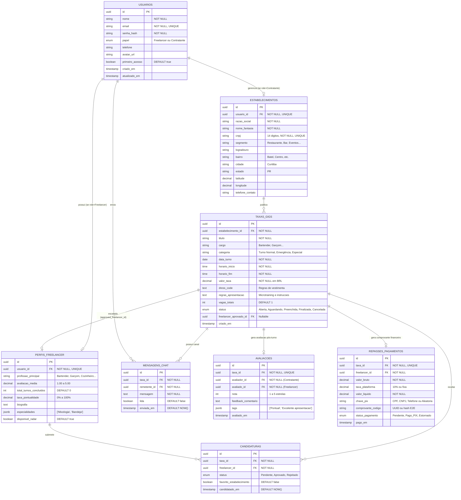

# Modelo Entidade-Relacionamento (MER) - TrampoTaxa (Loctaxa)

Este documento apresenta a modelagem de banco de dados relacional (MER e DER) da plataforma **TrampoTaxa**, projetada para suportar a comunicação síncrona entre o **Front-End Web** e o **Aplicativo Mobile (React Native)**.

---

## 1. Diagrama Entidade-Relacionamento (Mermaid ERD)



---

## 2. Dicionário de Dados e Regras de Negócio

### 2.1 Tabela `USUARIOS`
Centraliza o controle de acesso e autenticação RBAC da plataforma:
* **`id` (UUID, PK):** Identificador universal.
* **`papel` (Enum):** `'Freelancer'` ou `'Contratante'`. Determina a experiência de navegação e permissões.
* **`primeiro_acesso` (Boolean):** Flag que identifica se o usuário precisa concluir o preenchimento de perfil no onboarding.

### 2.2 Tabela `ESTABELECIMENTOS`
Armazena os dados fiscais e geográficos das empresas contratantes:
* **`cnpj` (CHAR(14) ou VARCHAR(18)):** Validado pelo algoritmo dos dígitos verificadores (Módulo 11).
* **`latitude` e `longitude`:** Permitem o cálculo de proximidade euclidiana/geodésica para o radar de oportunidades.

### 2.3 Tabela `TAXAS_GIGS`
Representa os turnos de trabalho temporário:
* **Transições de Status:**
  `Aberta` ➔ `Aguardando Confirmação` ➔ `Preenchida` (quando o contratante aprova o freelancer) ➔ `Finalizada` (após a realização do turno) ➔ `Avaliada & Paga`.

---

## 3. Código DBML (Para importação no dbdiagram.io)

Copie e cole o código abaixo diretamente no [dbdiagram.io](https://dbdiagram.io/):

```dbml
Table usuarios {
  id uuid [pk]
  nome varchar(120) [not null]
  email varchar(180) [unique, not null]
  senha_hash varchar(255) [not null]
  papel varchar(20) [not null] // 'Freelancer' | 'Contratante'
  telefone varchar(20)
  avatar_url varchar(255)
  primeiro_acesso boolean [default: true]
  criado_em timestamp [default: `now()`]
}

Table estabelecimentos {
  id uuid [pk]
  usuario_id uuid [unique, ref: - usuarios.id]
  razao_social varchar(150) [not null]
  nome_fantasia varchar(120) [not null]
  cnpj varchar(18) [unique, not null]
  segmento varchar(60) [not null]
  bairro varchar(60)
  cidade varchar(60) [default: 'Curitiba']
  latitude decimal(10,6)
  longitude decimal(10,6)
}

Table perfis_freelancer {
  id uuid [pk]
  usuario_id uuid [unique, ref: - usuarios.id]
  profissao varchar(60) [not null]
  avaliacao_media decimal(3,2) [default: 5.00]
  total_turnos int [default: 0]
  taxa_pontualidade int [default: 100]
  biografia text
}

Table taxas_gigs {
  id uuid [pk]
  estabelecimento_id uuid [ref: > estabelecimentos.id]
  titulo varchar(120) [not null]
  cargo varchar(50) [not null]
  categoria varchar(40) [not null]
  data_turno date [not null]
  horario_inicio time [not null]
  horario_fim time [not null]
  valor_taxa decimal(10,2) [not null]
  dress_code text
  regras_apresentacao text
  status varchar(30) [default: 'Aberta']
  freelancer_aprovado_id uuid [ref: > perfis_freelancer.id]
}

Table candidaturas {
  id uuid [pk]
  taxa_id uuid [ref: > taxas_gigs.id]
  freelancer_id uuid [ref: > perfis_freelancer.id]
  status varchar(20) [default: 'Pendente']
  favorito boolean [default: false]
  candidatado_em timestamp [default: `now()`]
}

Table avaliacoes {
  id uuid [pk]
  taxa_id uuid [unique, ref: - taxas_gigs.id]
  avaliador_id uuid [ref: > usuarios.id]
  avaliado_id uuid [ref: > perfis_freelancer.id]
  nota int [not null]
  feedback text
  avaliado_em timestamp [default: `now()`]
}

Table mensagens_chat {
  id uuid [pk]
  taxa_id uuid [ref: > taxas_gigs.id]
  remetente_id uuid [ref: > usuarios.id]
  mensagem text [not null]
  lida boolean [default: false]
  enviada_em timestamp [default: `now()`]
}
```
